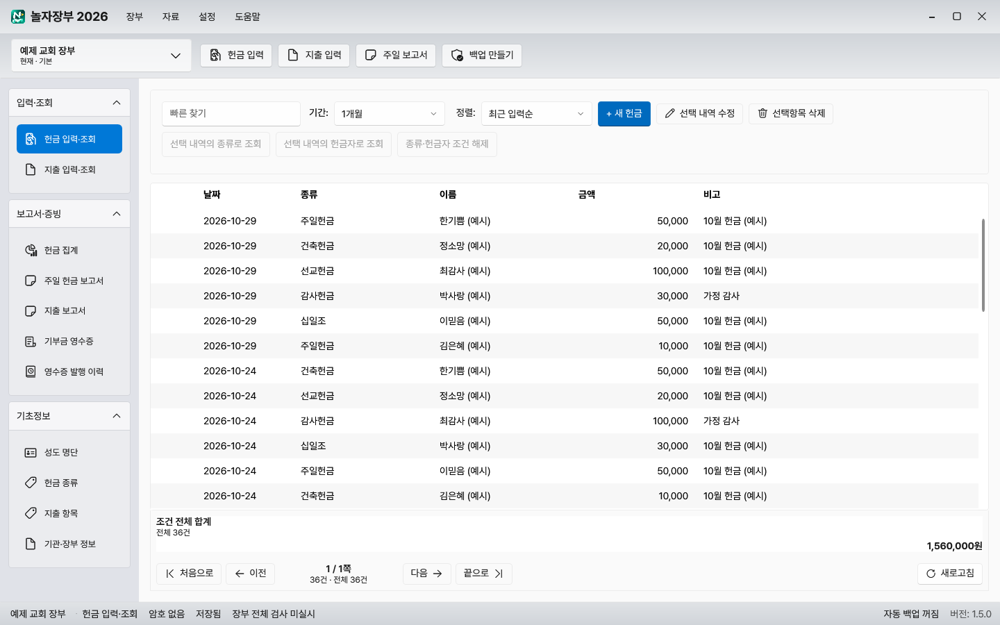
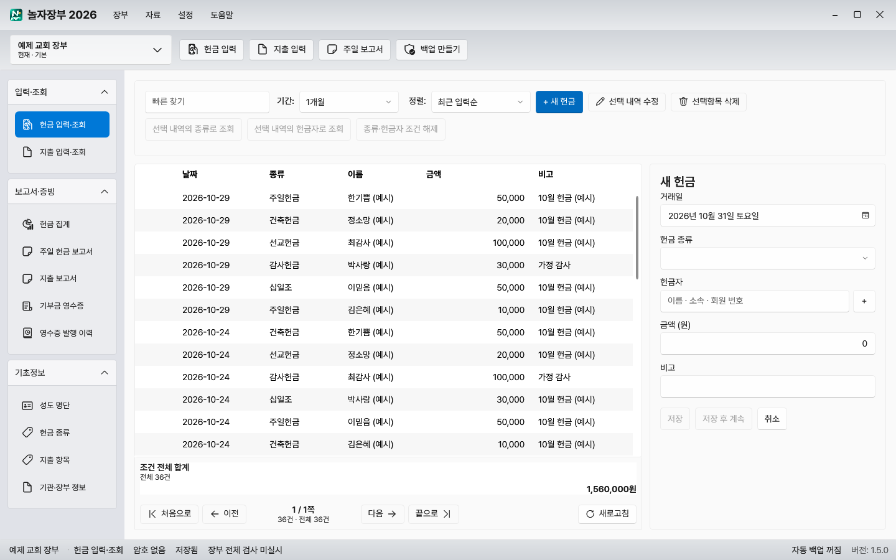
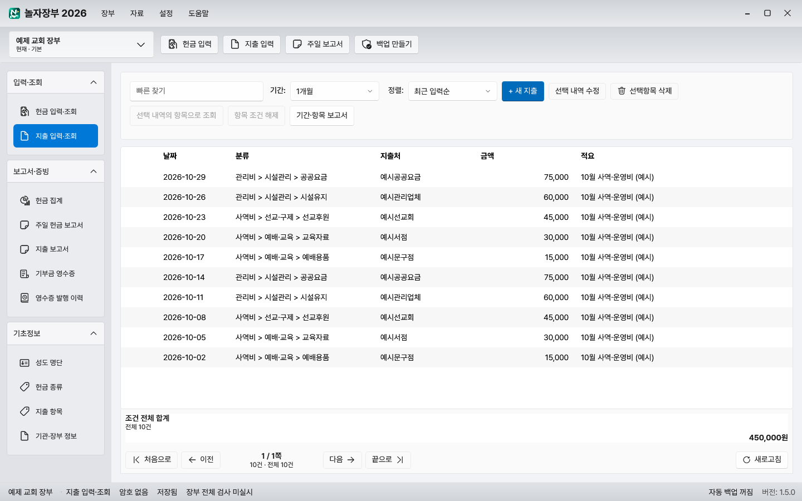
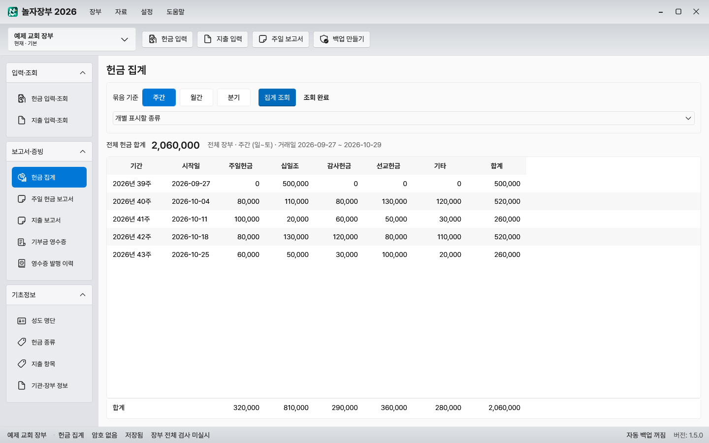
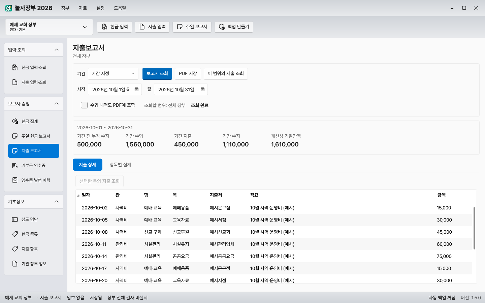
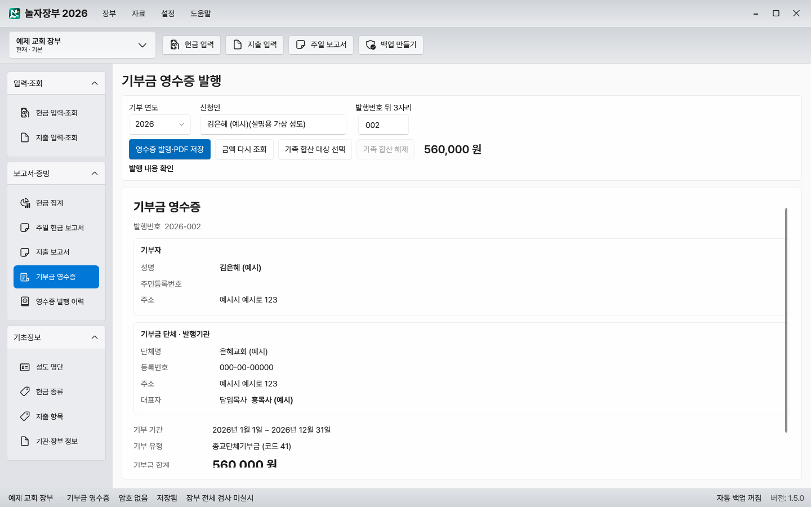
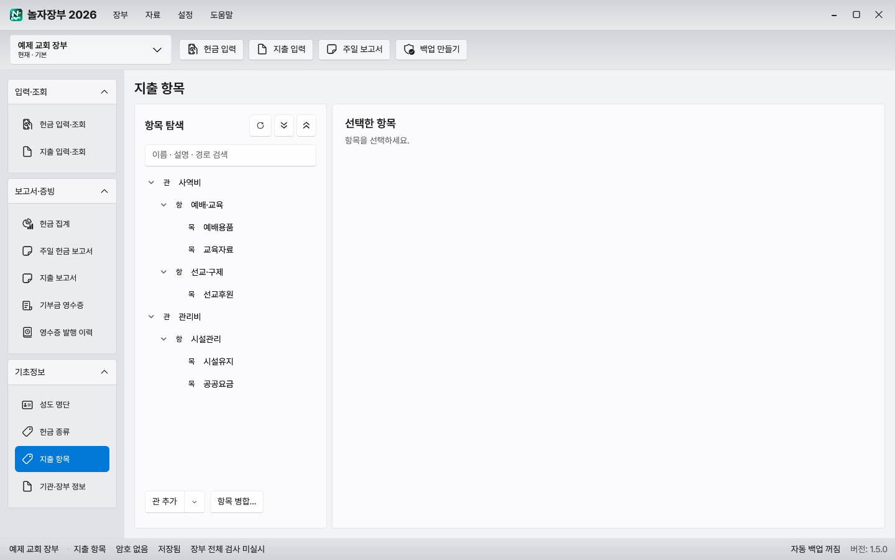

# 놀자장부 2026 · v1.5.0

교회의 **헌금·지출 입력부터 집계, 보고서, 기부금 영수증, 백업까지** 한 곳에서 관리하는 Windows 장부 프로그램입니다. 여러 해의 자료를 하나의 운영 장부에 계속 보관할 수 있습니다.

**[설치 파일 다운로드](https://github.com/timothy97/NoljaAccountBook2_Release/releases/tag/v1.5.0)** · **[사용자 매뉴얼](https://github.com/timothy97/NoljaAccountBook2_Release/wiki)** · **[최신 릴리스](https://github.com/timothy97/NoljaAccountBook2_Release/releases/latest)**

> 화면은 v1.5.0의 실제 프로그램 화면입니다. 설명을 위한 예제 장부이며 인물·기관·거래·발행 이력은 모두 가상입니다.

## 설치하고 시작하기

1. Windows **x64** 환경에 **[.NET 10 Desktop Runtime의 Windows x64](https://dotnet.microsoft.com/ko-kr/download/dotnet/10.0)**를 설치합니다. 다운로드 페이지의 **Desktop Runtime**을 선택하세요. 일반 .NET Runtime만 설치한 경우 WPF 앱을 실행할 수 없습니다.
2. [v1.5.0 릴리스](https://github.com/timothy97/NoljaAccountBook2_Release/releases/tag/v1.5.0)의 Assets에서 **`NoljaAccountBook2026_Installer.v1.5.0.exe`**를 내려받습니다.
3. 설치 파일을 실행하고 현재 사용자/모든 사용자 및 설치 위치를 선택합니다. Windows에서 관리자 승인을 요청할 수 있습니다.
4. 시작 메뉴나 바탕화면의 **놀자장부 2026**을 실행합니다.
5. 처음 사용하는 경우 **새 장부 만들기**, 기존 운영 장부가 있는 경우 **기존 장부 등록**으로 시작합니다.

이 배포본은 **ReadyToRun · Release · win-x64** 빌드입니다. .NET Desktop Runtime은 설치 파일에 포함되어 있지 않습니다.

## 무엇을 할 수 있나요?

| 업무 | 주요 기능 |
|---|---|
| 헌금 입력·조회 | 성도 후보 선택, 명시적인 저장/수정, 기간·검색·정렬, 조건 전체 합계, 페이지 이동 |
| 지출 입력·조회 | 관→항→목 선택, 지출처·적요 입력, 기간별 조회와 합계 |
| 헌금 집계 | 주간·월간·분기별 집계, 헌금 종류별 금액과 전체 합계 |
| 보고서 | 주일 헌금 보고서, 지출 보고서, 화면 검토 후 PDF 저장 |
| 기부금 영수증 | 연도·신청인 선택, 가족 합산, 발행번호, PDF 발행과 이력 조회 |
| 기초정보 | 성도 명단, 헌금 종류, 지출 항목의 관·항·목 트리, 기관·장부 정보와 도장 |
| 장부 관리 | 여러 장부 등록·선택·기본 장부 지정, 사본, 일부 자료로 새 장부 만들기 |
| 자료 보호·교환 | 운영 장부 암호, 전체/자동 백업, 전체 복원, 기간 자료 교환, 엑셀 내보내기 |
| 화면 | 밝은·어두운·Excel 테마, 단계별 로딩 스플래시 |

## 주요 화면

### 헌금과 지출: 조회와 입력을 구분해서 사용합니다

목록에서 내역을 선택한 뒤 **선택 내역 수정**으로 편집합니다. 새 거래는 **새 헌금/새 지출**에서 시작하고 **저장** 또는 **저장 후 계속 입력**으로 확정합니다. 목록 선택만으로 거래가 저장되지는 않습니다.

지출은 **관→항→목**의 마지막 항목을 선택해 기록합니다. 목록 아래 **조건 전체 합계**는 현재 검색·기간 조건에 맞는 전체 내역의 합계입니다.

### 집계·보고서: 조건을 확인하고 PDF로 남깁니다

헌금 집계는 주간·월간·분기를 비교할 수 있습니다. 보고서는 화면에서 기준일·기간·범위를 확인하고 생성한 뒤 **PDF 저장**을 선택합니다.

지출 보고서는 기간 전 누적 수지, 기간 수입·지출, 기간 수지와 계산상 기말잔액을 구분합니다. **계산상 잔액은 실제 통장 잔액과 대사한 값이 아닙니다.**

### 기부금 영수증: 금액을 검토하고 발행합니다

연도와 신청인을 선택하고 필요하면 가족 합산을 적용합니다. **발행 및 영수증 PDF 저장**을 실행해야 발행 이력이 기록됩니다. 화면을 여는 것만으로 발행되지는 않습니다.

### 기초정보: 명단과 관·항·목을 정리합니다

성도 명단, 헌금 종류, 지출 항목을 별도로 관리합니다. 지출 항목은 트리에서 선택하고 상세·연결 지출을 확인할 수 있습니다.

## 파일 세 가지를 구분하세요

| 확장자 | 용도 | 사용할 때 |
|---|---|---|
| **`.nabdb`** | 계속 사용하는 운영 장부 | 평소 입력·조회·수정 |
| **`.nabbackup`** | 장부 전체 백업 | 장애 대비 보관 및 백업 시점으로 전체 복원 |
| **`.nabx`** | 기간 자료 교환 | 지정 기간을 내보내 다른 장부에 누적 가져오기 |

운영 장부는 명시적으로 저장한 입력을 반영합니다. `Ctrl+S`로 현재 편집을 반영하고 저장 완료 상태를 확인할 수 있습니다. **전체 복원은 대상 장부를 백업 시점으로 교체**합니다. `.nabx`는 운영 장부나 전체 백업의 대체물이 아니며, **같은 교환 파일을 다시 가져오면 거래가 다시 추가될 수 있습니다.**

## 자주 쓰는 작업과 매뉴얼

- [설치·첫 장부 만들기](https://github.com/timothy97/NoljaAccountBook2_Release/wiki/01-Getting-Started)
- [장부 전환·백업·복원·기간 교환](https://github.com/timothy97/NoljaAccountBook2_Release/wiki/02-Books-and-Backup)
- [헌금·지출 입력, 수정, 검색](https://github.com/timothy97/NoljaAccountBook2_Release/wiki/03-Income-and-Expense)
- [집계·주일 보고서·지출 보고서](https://github.com/timothy97/NoljaAccountBook2_Release/wiki/04-Reports)
- [영수증 발행·가족 합산·발행 이력](https://github.com/timothy97/NoljaAccountBook2_Release/wiki/05-Donation-Receipts)
- [명단·헌금 종류·지출 항목·기관 정보](https://github.com/timothy97/NoljaAccountBook2_Release/wiki/06-Members-and-Categories)
- [테마·암호·단축키·문제 해결](https://github.com/timothy97/NoljaAccountBook2_Release/wiki/07-Settings-and-Troubleshooting)

## v1.5.0에서 달라진 점

- 영구 운영 장부, 전체 백업과 기간 교환의 역할을 구분했습니다.
- 헌금·지출의 명시적인 입력/수정과 페이지 조회·전체 합계를 제공합니다.
- 보고서·영수증 화면과 미리보기를 정리하고, 주일 보고서 이름 숨김을 기본으로 적용했습니다.
- 지출 항목 트리의 전체 펼치기/접기, 새 프로그램·설치 아이콘과 중앙형 스플래시를 적용했습니다.
- 밝은·어두운·Excel 테마를 지원합니다.

## 다운로드 확인과 라이선스

설치 파일의 SHA-256은 릴리스에 함께 제공하는 `SHA256SUMS.txt`와 비교할 수 있습니다.

라이선스는 [LICENSE](https://github.com/timothy97/NoljaAccountBook2_Release/blob/main/LICENSE)를 확인하세요. 글꼴·라이브러리 고지는 설치 폴더의 해당 라이선스 파일을 참고하세요.
