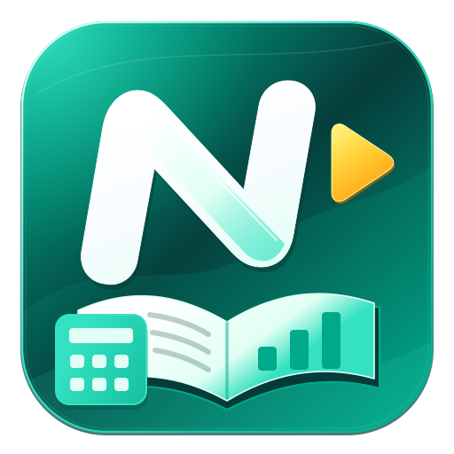
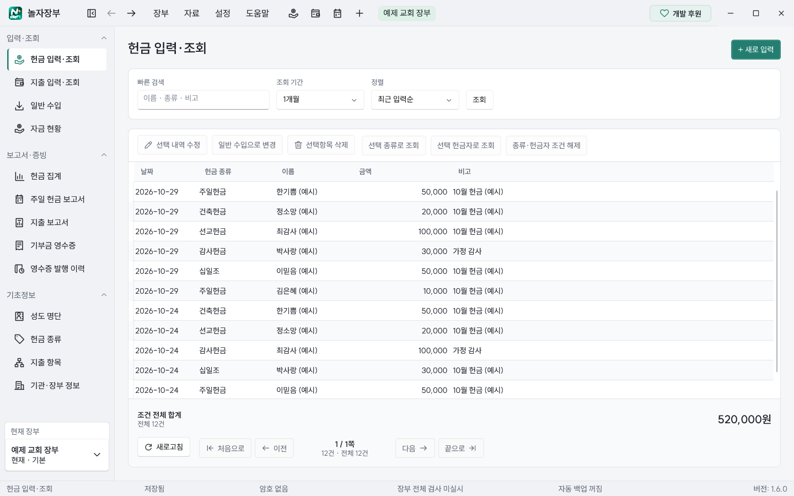
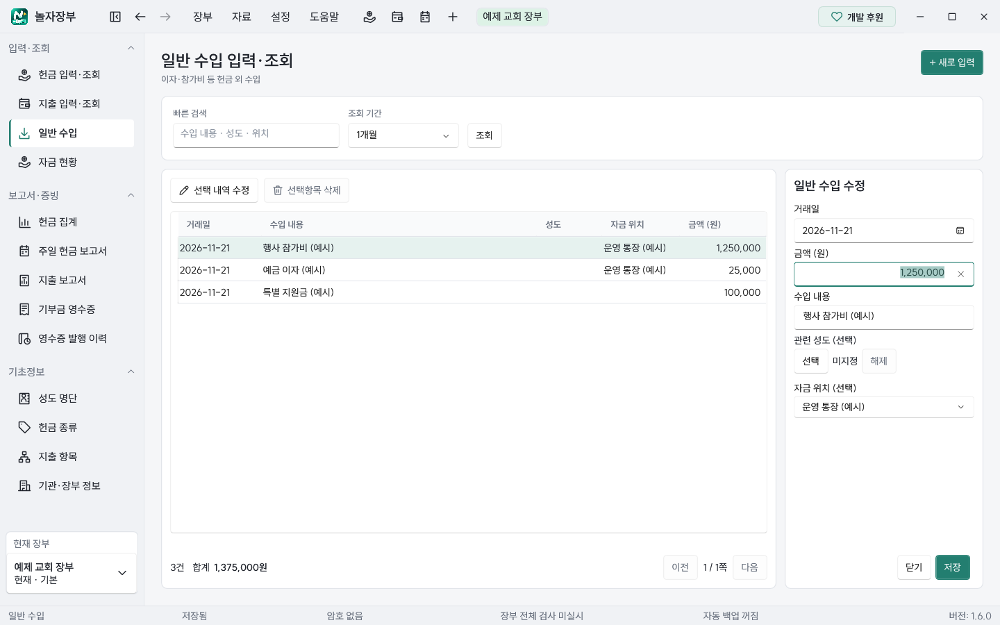
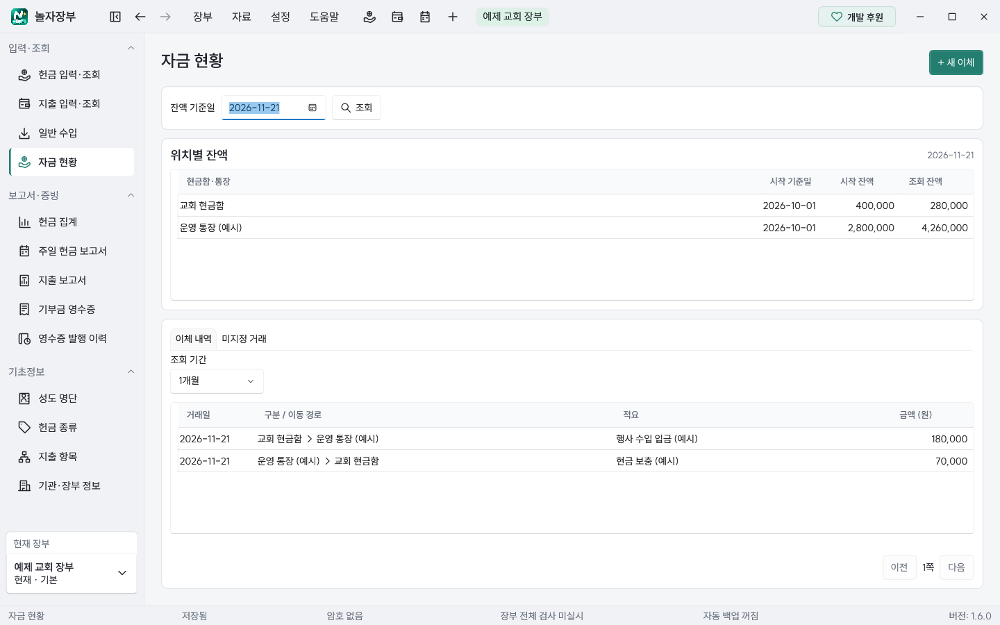
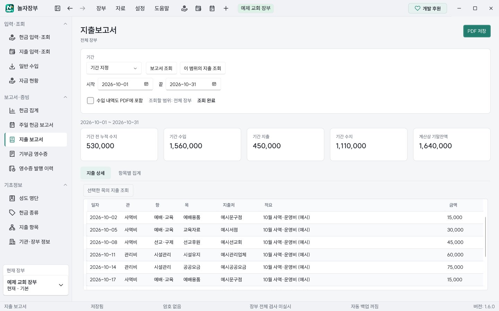
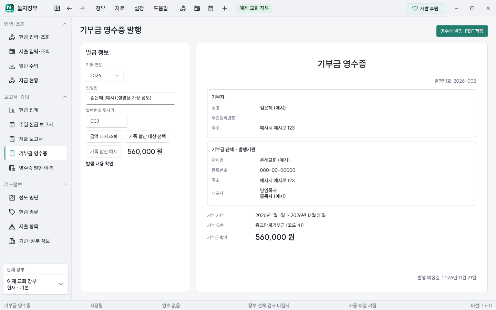
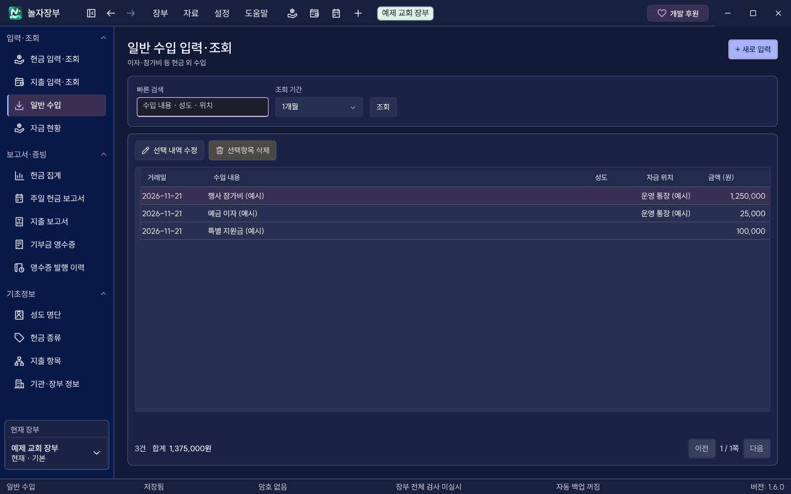

# 놀자장부 2026 · v1.6.0

교회의 헌금·지출부터 일반 수입, 현금·통장 잔액, 보고서와 기부금 영수증까지 관리하는 Windows 장부 프로그램입니다. **등록 인원과 후원 여부에 관계없이 무료**입니다. [소프트웨어 사용권 계약](LICENSE)

**[v1.6.0 설치 파일](https://github.com/timothy97/NoljaAccountBook2_Release/releases/tag/v1.6.0)** · **[사용자 매뉴얼](https://github.com/timothy97/NoljaAccountBook2_Release/wiki)** · **[최신 릴리스](https://github.com/timothy97/NoljaAccountBook2_Release/releases/latest)**

화면은 v1.6.0에서 캡처했습니다. 인물·기관·거래·발행 이력은 설명용 가상 자료입니다.

## 설치하고 시작하기

1. Windows x64에 [.NET 10 Desktop Runtime x64](https://dotnet.microsoft.com/ko-kr/download/dotnet/10.0)를 설치합니다. 다운로드 페이지에서 **Desktop Runtime**을 선택합니다.
2. 릴리스의 **Assets**에서 `NoljaAccountBook2026_Installer.v1.6.0.exe`를 내려받습니다. 업데이트는 장부를 백업하고 프로그램을 닫은 뒤 진행합니다.
3. 설치 파일을 실행해 사용권과 설치 위치를 확인합니다. 설치 후 시작 메뉴에서 **놀자장부 2026**을 실행합니다.
4. 처음 사용한다면 **새 장부 만들기**, 기존 운영 장부가 있다면 **기존 장부 등록**을 선택합니다. 이전 버전의 전체 `.nabx`는 새 장부 만들기에서 변환합니다.

설치 파일은 Release / win-x64 / ReadyToRun 배포본입니다. 설치 파일의 SHA-256은 릴리스의 `SHA256SUMS.txt`에서 확인할 수 있습니다.

## 거래와 자금 현황

**새로 입력**에서 거래를 작성해 저장합니다. 기존 거래는 목록을 더블클릭하거나 **선택 내역 수정**으로 엽니다. 거래일 기준 기간·검색 조건의 전체 합계를 확인할 수 있습니다.

**설정 → 사용할 재정 기능…**에서 필요에 따라 장부별로 기능을 켭니다.

- **일반 수입과 지출 반환**을 켜면 이자·참가비 등 헌금 외 수입을 기록하고, 돌려받은 금액을 원지출에 연결할 수 있습니다.
- **자금 현황**을 켜면 현금함·통장의 시작 기준일과 잔액을 등록하고 거래 위치를 지정할 수 있습니다. 이체 내역은 기본 최근 1개월이며, 다른 기간으로도 조회할 수 있습니다. 미지정 거래는 목록에서 원래 편집 화면으로 이동해 자금 위치를 지정합니다.

## 집계·보고서·기부금 영수증

회계년도별 헌금 집계와 주일 헌금 보고서, 기간·항목별 지출 보고서를 확인하고 PDF로 저장할 수 있습니다. 기부금 영수증은 연도와 신청인, 가족 합산 금액을 확인한 뒤 발행하며 발행 이력을 남깁니다.

## 장부 관리와 자료 보호

여러 장부를 등록하고 전환할 수 있습니다. 명단과 헌금 종류, 관→항→목 분류, 기관 정보와 직인은 장부별로 관리합니다.

| 파일 | 용도 |
| --- | --- |
| `.nabdb` | 평소 거래를 입력하고 조회하는 운영 장부 |
| `.nabbackup` | 장부 전체 백업과 전체 복원 |
| `.nabx` | 지정한 기간의 거래를 다른 장부에 누적하는 교환 파일 |

장부 전체 복원은 대상 장부를 백업 시점으로 교체합니다. 같은 기간 자료를 반복해서 가져오면 거래가 다시 추가될 수 있습니다. 운영 장부 암호와 자동 백업은 **설정**에서 관리합니다.

## 화면 테마와 작업 동선

**설정 → 화면 테마**에서 밝기 모드와 테마 종류를 따로 선택합니다. 기본·엑셀·잉크드·슬레이트·라피스 벨벳·파이어사이드는 모두 밝은 버전과 어두운 버전을 제공합니다. 시스템 모드는 Windows 앱 모드를 따릅니다. `.theme.json` 파일로 새 테마를 추가할 수 있습니다.

사이드바를 접고 펼치거나 뒤로·앞으로 이동할 수 있습니다. 즐겨찾기 중 창 너비에 들어가지 않는 항목은 **더보기**에서 기존 순서대로 찾을 수 있습니다.

## 사용법과 지원

- [설치와 첫 장부](https://github.com/timothy97/NoljaAccountBook2_Release/wiki/01-Getting-Started) · [장부·백업·복원](https://github.com/timothy97/NoljaAccountBook2_Release/wiki/02-Books-and-Backup)
- [헌금·지출 입력](https://github.com/timothy97/NoljaAccountBook2_Release/wiki/03-Income-and-Expense) · [집계·보고서](https://github.com/timothy97/NoljaAccountBook2_Release/wiki/04-Reports) · [기부금 영수증](https://github.com/timothy97/NoljaAccountBook2_Release/wiki/05-Donation-Receipts)
- [명단과 기초정보](https://github.com/timothy97/NoljaAccountBook2_Release/wiki/06-Members-and-Categories) · [설정과 문제 해결](https://github.com/timothy97/NoljaAccountBook2_Release/wiki/07-Settings-and-Troubleshooting)
- [일반 수입·지출 반환·자금 현황](https://github.com/timothy97/NoljaAccountBook2_Release/wiki/08-Church-Finance) · [테마 파일 작성](https://github.com/timothy97/NoljaAccountBook2_Release/wiki/09-Theme-Files)

프로그램의 **도움말 → 사용자 매뉴얼 (웹)**에서 최신 위키를 열 수 있습니다. **프로그램 정보**에서는 사용권과 제3자 고지를 확인할 수 있습니다. 개발 후원은 자율입니다.
